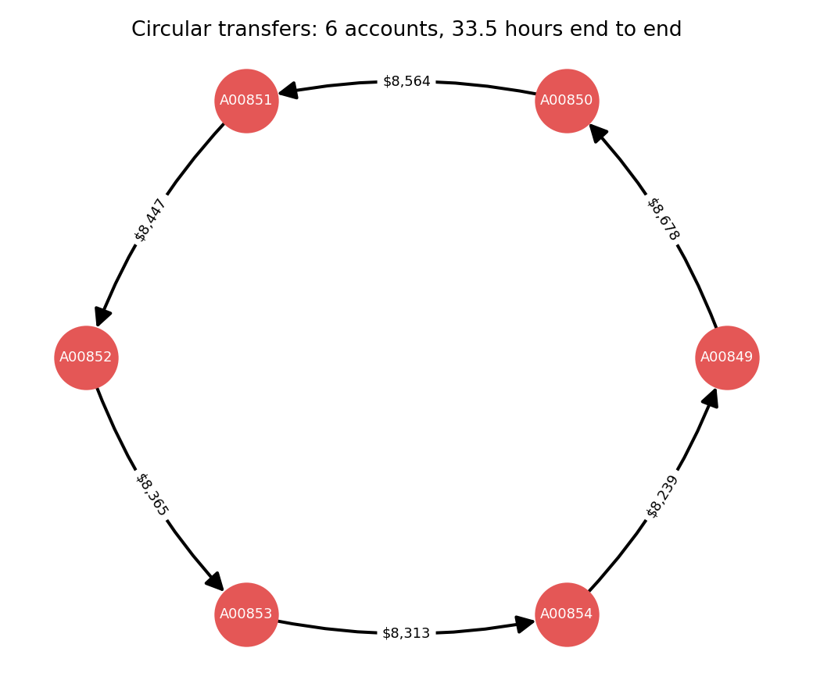
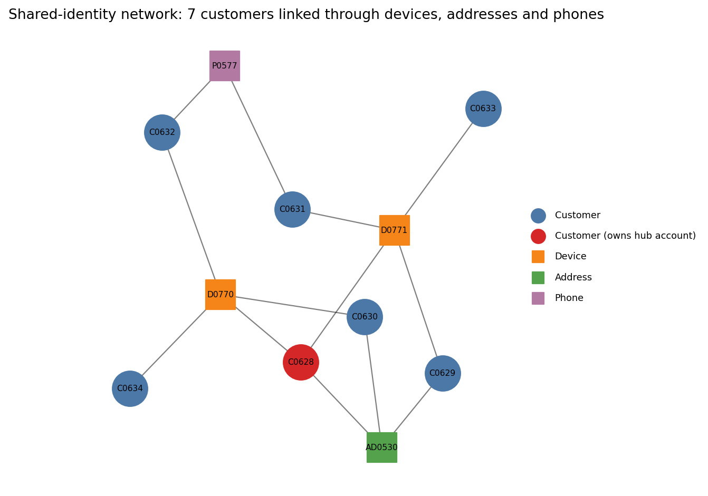
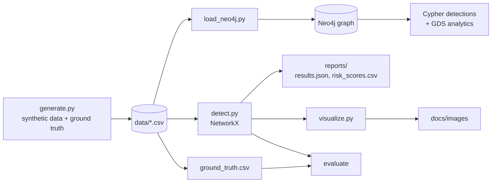

# Fraud & AML Detection Knowledge Graph

A knowledge graph for fraud and anti-money-laundering (AML) investigation. It models customers, accounts, devices, addresses, phones, and transfers as a graph, then finds suspicious networks with graph queries and algorithms in **Neo4j** (Cypher and Graph Data Science) and in an offline **Python / NetworkX** implementation of the same rules.

The dataset is synthetic and reproducible. It contains planted fraud patterns plus benign look-alikes, so every detection can be scored against ground truth.





## What it detects

| Pattern | Signal | Cypher | Python |
|---|---|---|---|
| Circular transfers (layering) | 3 to 6 hop cycles, each hop at least $1,000, all within 72 hours, amounts within 15% of each other | `Q1` in `cypher/02_detections.cypher` | `detect_rings` |
| Mule networks | Customers connected through shared devices, addresses, or phones, in groups of 4 or more | `Q2`, weakly connected components in `cypher/03_gds_analytics.cypher` | `detect_identity_clusters` |
| Structuring | 5 or more cash deposits of $9,000 to $9,999 inside any 7-day window | `Q3` | `detect_structuring` |
| Pass-through mule hubs | 10 or more distinct senders, at least 80% of inflow forwarded to 3 or fewer recipients | `Q4` | `detect_mule_hubs` |
| Network context | Louvain communities and weighted PageRank to prioritise what to investigate first | `cypher/03_gds_analytics.cypher` | `communities`, `pagerank` |

Each flagged account also gets a simple additive risk score and a list of reasons (`reports/risk_scores.csv`).

## Architecture



See [docs/ontology.md](docs/ontology.md) for the full schema and the reasoning behind the modeling choices.

## Quick start

### Option A: offline, no database

```bash
git clone <your-repo-url> && cd aml-fraud-knowledge-graph
python -m venv .venv && source .venv/bin/activate
pip install -r requirements.txt

make data      # regenerate the synthetic dataset (seed 42)
make detect    # run all detections and print metrics
make figures   # render the figures above
make test      # run the test suite
```

### Option B: Neo4j

```bash
docker compose up -d              # Neo4j 5 Community with the Graph Data Science plugin
export NEO4J_PASSWORD=changeme123 # or copy .env.example
make load                         # constraints + nodes + relationships
```

Open Neo4j Browser at http://localhost:7474 (user `neo4j`) and paste the queries from `cypher/02_detections.cypher` and `cypher/03_gds_analytics.cypher` one block at a time. Compare their output with the Python results in `reports/results.json`.

## Results on the synthetic dataset

Dataset: 661 customers, 903 accounts, 3,845 transfers and cash deposits (seed 42).

Planted patterns: 5 rings (27 accounts), 4 mule networks (28 customers, 4 hub accounts), and 6 structuring accounts. The data also contains benign decoys that look similar: roommate payment loops with unequal amounts, a loop spread over 10 days, payroll-style accounts that fan money out to many recipients, households that share an address or device, and legitimate one-off cash deposits just under $10,000.

| Pattern | True positives | False positives | False negatives | Precision | Recall |
|---|---|---|---|---|---|
| Circular transfers (accounts) | 27 | 0 | 0 | 1.00 | 1.00 |
| Mule networks (customers) | 28 | 0 | 0 | 1.00 | 1.00 |
| Mule hubs (accounts) | 4 | 0 | 0 | 1.00 | 1.00 |
| Structuring (accounts) | 6 | 0 | 0 | 1.00 | 1.00 |

Other findings:

- All four planted hubs are in the top 10 accounts by PageRank (out of 903).
- Louvain splits the transfer network into 24 communities.
- 61 accounts end up with a non-zero risk score.
- The test suite checks the same recall and precision across five different random seeds.

**How to read these numbers:** the patterns are planted with clear structure, and the thresholds are chosen to fit them, so perfect scores show that the pipeline works end to end, not how it would perform on real banking data. Real transaction data is noisier, labels are scarce, and thresholds have to be tuned against false-positive cost.

## Repository layout

```
aml_graph/
  generate.py      synthetic data, planted patterns, decoys, ground truth
  detect.py        NetworkX detections, risk scoring, evaluation
  load_neo4j.py    CSV to Neo4j loader (batched, idempotent with MERGE)
  visualize.py     README figures
cypher/            schema, detection queries, GDS analytics
data/              generated CSVs (committed so the project runs immediately)
reports/           results.json and risk_scores.csv from the default run
docs/              ontology and figures
tests/             reproducibility and detection tests
```

## Design notes

- **Rules first, graph for context.** Each detector is a transparent rule an analyst can read and challenge. Graph algorithms (communities, PageRank) are used to prioritise and expand an investigation rather than as black-box verdicts.
- **Thresholds are parameters.** Every detector in `detect.py` exposes its thresholds as function arguments, and the Cypher queries use the same numbers.
- **Reproducibility.** Everything is seeded, so anyone can regenerate the exact dataset and results.

## Limitations

- Synthetic data only. No real customer data is used or included.
- Rules are fixed thresholds and are not learned from data.
- The Cypher cycle search uses variable-length paths, which is fine at this scale but will not scale to millions of edges without time-bounded traversals or a GDS-based approach.
- This is an educational portfolio project, not a compliance or production AML system.

## Roadmap

- Natural-language investigation over the graph (GraphRAG): ask "who is connected to this hub?" and get an answer grounded in graph queries.
- Promote transfers to transaction nodes so alerts and cases can link to them.
- Add a learned risk score (for example node embeddings plus a classifier) and compare it with the rule-based score.
- Add the manufacturing supply chain and OT security risk graph as a second domain.

## License

MIT. See [LICENSE](LICENSE).
