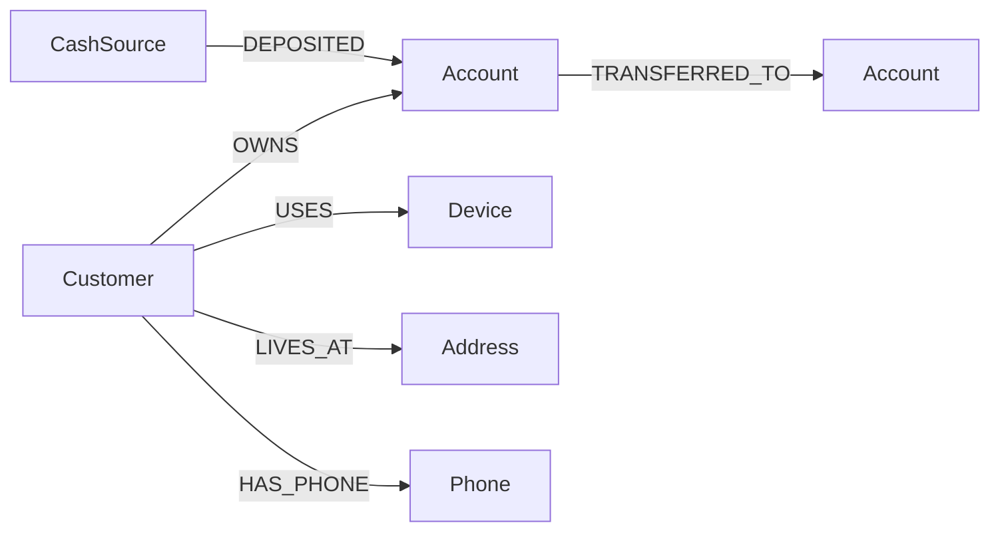

# Ontology

The graph models who controls which accounts, which identity attributes they share, and
how money moves.

## Nodes

| Label | Key | Properties |
|---|---|---|
| Customer | customer_id | name, country, risk_rating (low, medium, high), onboarded |
| Account | account_id | account_type, opened, status |
| Device | device_id | device_type |
| Address | address_id | street, city, state |
| Phone | phone_id | number |
| CashSource | source_id | A single node (`EXT-CASH`) that represents cash entering the bank |

## Relationships

| Type | From to | Properties |
|---|---|---|
| OWNS | Customer to Account | none |
| USES | Customer to Device | none |
| LIVES_AT | Customer to Address | none |
| HAS_PHONE | Customer to Phone | none |
| TRANSFERRED_TO | Account to Account | txn_id, amount, ts, ts_epoch, channel |
| DEPOSITED | CashSource to Account | txn_id, amount, ts, ts_epoch, channel |

## Design decisions

- **Transfers are relationships, not nodes.** Cycle search, path queries, and GDS projections
  all work directly on account-to-account edges. The trade-off is that a transaction cannot
  have its own relationships (for example to a case or an alert). If you need that, promote
  transfers to `(:Transaction)` nodes.
- **Cash is a separate label.** Cash deposits come from outside the account network. Giving
  them their own node and relationship type (`CashSource`, `DEPOSITED`) keeps them out of cycle
  and community analysis, so one giant "cash" node does not connect the whole graph.
- **Shared attributes are nodes.** Making Device, Address, and Phone first-class nodes turns
  "who shares what" into a simple traversal and lets weakly connected components find networks.
- **`ts_epoch` is stored next to `ts`.** Integer seconds make time-window arithmetic simple and
  indexable in Cypher; `ts` stays a proper datetime for display.
